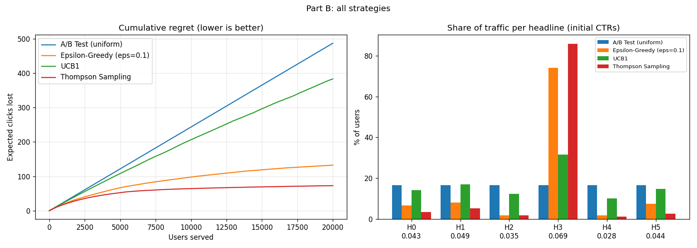
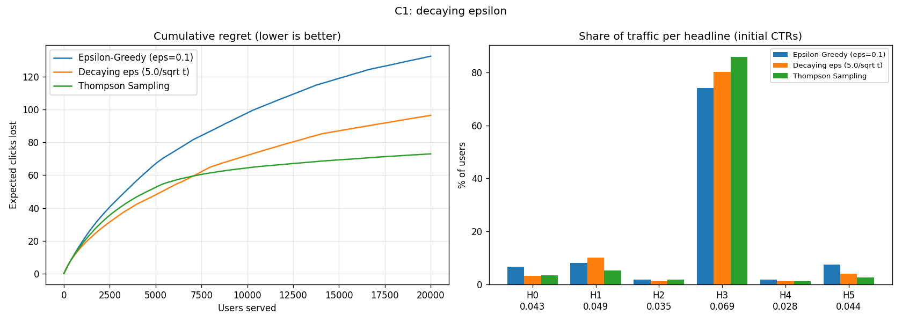
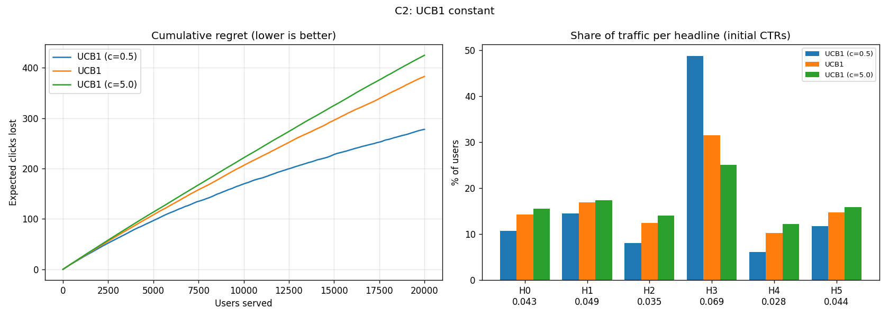
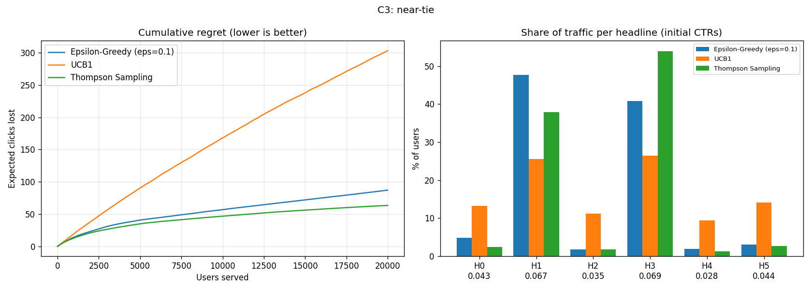
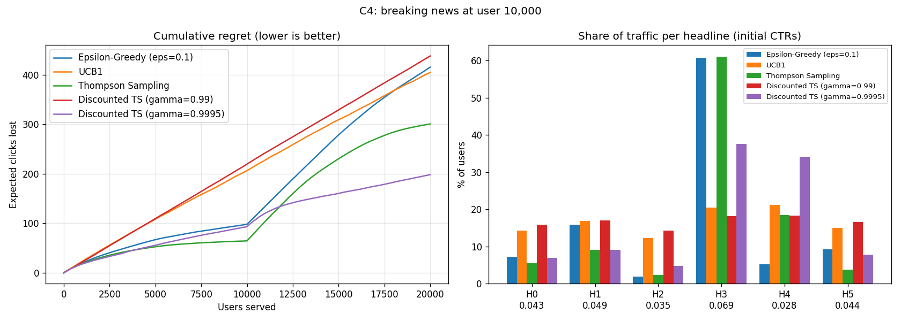

Results 
Overview
A news platform has 6 candidate headlines for one home-screen slot. Each visitor sees one headline and either clicks (reward 1) or not (reward 0). The goal is to collect as many clicks as possible, which is the same as minimising cumulative regret: the expected clicks lost by not always showing the best headline.

Part A: Implement UCB1 and Thompson Sampling 

UCB1
Show every headline once first. After that, show the headline with the highest upper confidence bound, where μ̂ᵢ is its observed CTR, Nᵢ is how often it was shown, t is the number of users so far and c is the exploration constant (self.c, default 2):
                 $$A_t = \arg\max_i \left[ \hat{\mu}_i + \sqrt{\frac{c \ln t}{N_i}} \right]

class UCB1(BaseAgent):
    def __init__(self, k, c=2.0):
        super().__init__(k)
        self.c = c
        self.name = "UCB1" if c == 2.0 else f"UCB1 (c={c})"
        self.t = 0

    def select_arm(self):
       self.t += 1
       for i in range(self.k):
        if self.counts[i] == 0:
            return int(i)
                
        bonus = np.sqrt(self.c * np.log(self.t) / self.counts)
        ucb_values = self.values + bonus
        
        return int(np.argmax(ucb_values))

Thompson Sampling 
Keep a Beta(αᵢ, βᵢ) belief for each headline's CTR, starting at Beta(1, 1). To choose, draw
one sample from every belief with 

class ThompsonSampling(BaseAgent):

    def __init__(self, k, seed=None):
        super().__init__(k)
        self.rng = np.random.default_rng(seed)
        self.alpha = np.ones(k, dtype=float)
        self.beta = np.ones(k, dtype=float)

    def select_arm(self):
        samples = self.rng.beta(self.alpha, self.beta)
        return int(np.argmax(samples))

    def update(self, arm, reward):
        super().update(arm, reward)
        if reward == 1:
            self.alpha[arm] += 1
        else:
            self.beta[arm] += 1       

check_my_work.py output
[PASS] Student ID is set
[PASS] UCB1: returns a valid int
[PASS] UCB1: shows every arm once first
[PASS] UCB1: bonus favours the least-shown arm
[PASS] UCB1: uses the constant c
[PASS] UCB1: beats the A/B test
[PASS] TS: starts with Beta(1, 1) beliefs
[PASS] TS: update() counts clicks and non-clicks
[PASS] TS: choices are random, not argmax of the mean
[PASS] TS: returns a valid int
[PASS] TS: finds the best headline
[PASS] TS: lower regret than UCB1 and the A/B test
============================================================
12/12 checks passed.
All checks passed. Now run mab_assignment.py for Parts B and C.

Part B: Compare the four strategies

Student ID 361110 -> TRUE_CTR = [0.043, 0.049, 0.035, 0.069, 0.028, 0.044]
Best headline: H3

Part B: all strategies
Strategy                            Regret   % on best
------------------------------------------------------
A/B Test (uniform)                   486.7       16.7%
Epsilon-Greedy (eps=0.1)             132.4       74.0%
UCB1                                 383.0       31.6%
Thompson Sampling                     73.0       85.9%
Saved plot -> part_b.png

The provided plots show the simulation results of different headline selection strategies (A/B Test, Epsilon-Greedy, UCB1, and Thompson Sampling) evaluated over 20,000 users.

1.Rank the four strategies by regret. Why does the winner win?
The strategies ranked by cumulative regret from lowest (best) to highest (worst) are Thompson Sampling (73.0), e-Greedy (132.4), UCB1 (383.0), and Uniform A/B Test (486.7). Thompson Sampling wins because it uses a Bayesian approach, maintaining Beta$(\alpha_i, \beta_i) belief distributions for each headline's CTR and sampling from them to make decisions. This allows it to naturally balance exploration and exploitation by sampling in proportion to the probability that each arm is optimal, directing 85.9% of traffic to the best headline (H_3 with CTR 0.069). In contrast, the uniform A/B test wastes 83.3% of traffic on suboptimal choices, resulting in the highest regret.

2.Why does e-Greedy's regret curve never become flat, even after it has found the best headline?
e-Greedy's regret curve continues to grow linearly (never becoming completely flat) because of its constant exploration rate (e = 0.1). According to its decision rule, with a fixed probability of 10%, the agent ignores its learned values and chooses a completely random headline. Even though it identifies the best headline early, it perpetually keeps pulling suboptimal or worst-performing arms 10% of the time, generating a continuous, steady accumulation of regret over the 20,000 users.

3.UCB1 is a well-known algorithm, yet here it loses clearly to $\varepsilon$-Greedy. Explain why, using the size of its bonus term compared with the gaps between your CTRs.

UCB1 accumulates a high regret of 383.0 and spends only 31.6% of traffic on the best headline because its exploration bonus term, $\sqrt{\frac{c \ln t}{N_i}}$ (with c=2), remains too large relative to the small gaps between the true CTRs. For student ID 361110, the true best headline ($H_3$) has a CTR of 0.069, while the runner-up (H1) is 0.049, leaving a gap of 0.020. Because the UCB1 confidence bonus shrinks relatively slowly, it repeatedly over-explores suboptimal arms under the false uncertainty that they might be optimal, whereas e-Greedy exploits its estimated means much more aggressively once found.

Part C

Part C1 Decaying ε
output
C1: decaying epsilon
Strategy                            Regret   % on best
------------------------------------------------------
Epsilon-Greedy (eps=0.1)             132.4       74.0%
Decaying eps (5.0/sqrt t)             96.4       80.1%
Thompson Sampling                     73.0       85.9%
Saved plot -> part_c1.png

C2: UCB1 constant
Strategy                            Regret   % on best
------------------------------------------------------
UCB1 (c=0.5)                         277.9       48.8%
UCB1                                 383.0       31.6%
UCB1 (c=5.0)                         425.0       25.0%
Saved plot -> part_c2.png

C3: near-tie
Strategy                            Regret   % on best
------------------------------------------------------
Epsilon-Greedy (eps=0.1)              87.2       40.8%
UCB1                                 303.4       26.4%
Thompson Sampling                     63.5       53.9%
Saved plot -> part_c3.png

C4: breaking news at user 10,000
Strategy                            Regret   % on best
------------------------------------------------------
Epsilon-Greedy (eps=0.1)             415.4       34.7%
UCB1                                 404.6       28.9%
Thompson Sampling                    300.7       54.9%
Discounted TS (gamma=0.99)           438.0       23.3%
Discounted TS (gamma=0.9995)         198.2       64.9%
Saved plot -> part_c4.png

Explanation
In a non-stationary environment where the best and worst headlines swap their CTRs at user 10,000, standard stationary algorithms fail to adapt quickly. Standard Thompson Sampling and e-Greedy accumulate massive historical data pointing to the old best arm, making it extremely difficult to overcome accumulated Beta parameters or sample estimates when the environment changes.   The Discounted Thompson Sampling agent solves this by shrinking old evidence before every update using the rule $\alpha \leftarrow 1 + \gamma(\alpha - 1)$ and $\beta \leftarrow 1 + \gamma(\beta - 1)$. Comparing the two discount factors:   $\gamma = 0.99$ decays past evidence too aggressively (too fast), destroying historical confidence so quickly that the agent behaves almost like a short-memory or random sampler, resulting in high regret (438.0) and poor traffic allocation (23.3% on best).   $\gamma = 0.9995$ strikes the optimal balance: it retains enough long-term statistical power while systematically fading obsolete data after the swap at user 10,000. This allows Discounted TS ($\gamma = 0.9995$) to successfully detect the shift, recover faster than all other models, achieve the lowest regret (198.2), and direct 64.9% of traffic to the new best headline.

Part D: Recommendation

For our news platform's home-screen slot, we officially recommend deploying Thompson Sampling as our core production algorithm. Based on simulations across 20,000 user visits, Thompson Sampling outperformed all alternatives by a wide margin. It successfully captured 85.9% of user traffic on the absolute best headline, outperforming $\varepsilon$-Greedy (74.0%), UCB1 (31.6%), and a standard uniform A/B test (16.7%). Furthermore, it minimized total lost clicks (cumulative regret) down to just 73.0 clicks, compared to over 486 clicks lost under a traditional A/B test.   Why Thompson Sampling?Unlike a traditional static A/B test—which splits traffic equally regardless of performance and wastes valuable user engagement—Thompson Sampling dynamically learns in real time. It uses a probabilistic Bayesian framework that naturally shifts more traffic toward high-performing headlines while still maintaining a healthy, intelligent level of experimentation for newer or fluctuating content. 

  When Could This Go Wrong? (Risks & Limitations)While Thompson Sampling is exceptionally robust for stationary conditions, product managers should be aware of one critical failure mode: sudden audience shifts or breaking news events.   If a major news event happens mid-day and instantly alters user preferences (e.g., a sports headline suddenly becomes twice as engaging as the morning's top political headline), standard Thompson Sampling will struggle to adapt quickly. Because it relies on cumulative historical clicks stored in its memory, it will remain anchored to the old winning headline for too long.   Mitigation: If our news cycle experiences frequent, rapid mid-day shifts in audience interest, we should upgrade the production pipeline to Discounted Thompson Sampling (with $\gamma = 0.9995$), which explicitly discounts outdated historical data to react swiftly to breaking news